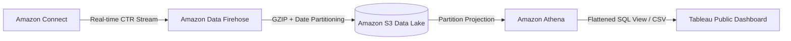

# Serverless Amazon Connect CTR Analytics Pipeline

An end-to-end, low-cost contact center analytics pipeline that streams real-time **Contact Trace Records (CTRs)** from **Amazon Connect** into **Amazon S3** via **Amazon Data Firehose**, queries nested JSON using **Amazon Athena (Partition Projection)**, and visualizes operational KPIs in **Tableau Public**.

## Architecture

## Live Interactive Dashboard
* **Tableau Public:** [View Live Dashboard](<PASTE-YOUR-TABLEAU-PUBLIC-LINK-HERE>)

## Key Highlights
* **Zero-Maintenance Partitioning:** Configured Athena Partition Projection (`year/month/day`) to eliminate manual `MSCK REPAIR TABLE` jobs or Glue Crawlers.
* **Nested JSON Flattening:** Built a reusable SQL view (`vw_connect_ctr_quicksight`) that unpacks nested `Agent`, `Queue`, and `Endpoint` structs into BI-ready columns.
* **Cost-Optimized BI:** Used GZIP compression in Firehose + Athena serverless queries + Tableau Public to keep infrastructure costs near zero.
* **Tracked Metrics:** Average Handle Time (AHT), Queue Wait Duration, After-Contact Work (ACW) Time, Disconnect Reasons, and Hourly Contact Volume.

## Repository Structure
* `sql/01_create_ctr_table.sql` – Athena external table DDL with Partition Projection.
* `sql/02_create_flattened_view.sql` – SQL view flattening nested CTR structs and ISO-8601 timestamps.
* `data/sample_ctr_flattened.csv` – Anonymized sample output from Athena.
* `screenshots/` – Visuals of the Athena query output and Tableau dashboard.
